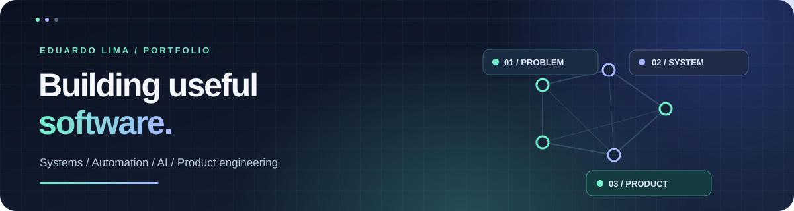
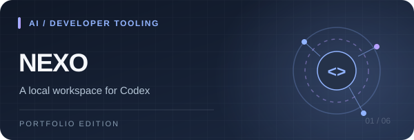
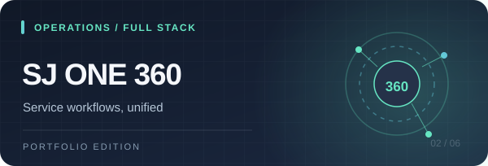
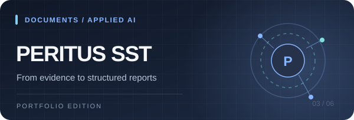
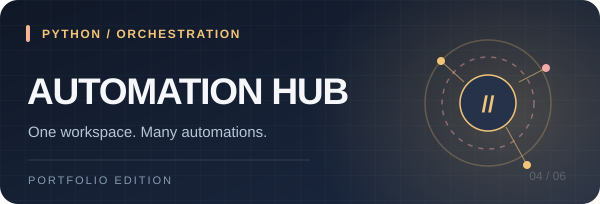
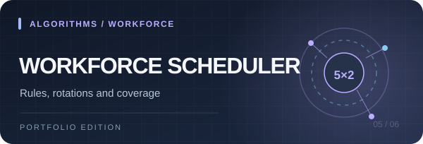
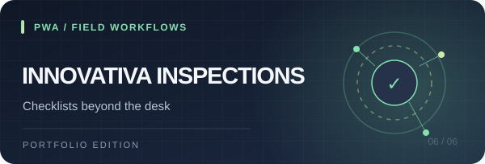

<strong>English</strong> &nbsp;·&nbsp; <a href="README.pt-BR.md">Português (Brasil)</a>

 

<h3>Full-Stack Developer &nbsp;·&nbsp; Automation &nbsp;·&nbsp; AI-Assisted Products</h3>

<strong>I turn messy real-world processes into software that feels simple.</strong>

I design and build applications, automations and operational tools that make everyday work clearer, faster and more reliable.

<a href="#featured-work"><strong>Explore my work ↓</strong></a> &nbsp;·&nbsp; <a href="#explore-more"><strong>More projects ↓</strong></a> &nbsp;·&nbsp; <a href="#lets-connect"><strong>Contact ↓</strong></a>

---

## ✦ Featured work

Six projects, six different engineering challenges — from local AI developer tools to field applications.

| | |
| :--- | :--- |
|  **[Nexo — Codex Workspace](https://github.com/EduSchorr/nexo-codex)** Local-first interface for Codex with conversation history, model controls, approvals and file attachments. Python · JavaScript · Developer Tools |  **[SJ One 360 — Operations Platform](https://github.com/EduSchorr/sj-one-360)** Customer-service workflows, analytics and automation brought together in a full-stack workspace. React · TypeScript · Python · SQLite |
|  **[Peritus SST — Document Intelligence](https://github.com/EduSchorr/peritus-sst)** OCR and optional AI assistance for organizing technical evidence and generating structured reports under professional review. Python · OCR · DOCX · AI-Assisted |  **[SAC Automation Hub — Orchestration](https://github.com/EduSchorr/sac-automation-hub)** Local control center for launching, scheduling and monitoring operational automations. Python · Processes · Scheduling |
|  **[Workforce Scheduler — Rules Engine](https://github.com/EduSchorr/sistema-escalas-sac)** 5×2 shift scheduling with weekend coverage, rotation constraints, permissions and audit records. Python · SQLite · Scheduling · CI |  **[Innovativa Inspections — Field PWA](https://github.com/EduSchorr/innovativa-inspecoes)** Responsive checklist and inspection prototype with local persistence and offline-friendly flows. JavaScript · PWA · Field UX |

The artwork above is illustrative. Repositories contain public, sanitized portfolio editions rather than production customer data.

---

## ◇ How I think about software

<table>
<tr>
<td width="25%" valign="top"><b>01 · Understand</b> Start with the people, pain points and actual process.</td>
<td width="25%" valign="top"><b>02 · Design</b> Model the states, rules, edge cases and user experience.</td>
<td width="25%" valign="top"><b>03 · Build</b> Connect interface, logic, data and integrations.</td>
<td width="25%" valign="top"><b>04 · Improve</b> Test, monitor, document and iterate.</td>
</tr>
</table>

**From problem → to a working product.** That's the thread connecting most of my projects.

---

## ◎ What I build

| **Operational platforms** | **Automation & integrations** | **Applied AI & document tools** |
| :--- | :--- | :--- |
| Internal systems, queues, dashboards, permissions and reporting. | Local tools, workflow orchestration and repetitive-task reduction. | AI-assisted interfaces, OCR, evidence organization and structured reports. |

## ⌘ Technology stack

| Focus | Tools |
| :--- | :--- |
| **Frontend & UX** | `React` · `TypeScript` · `JavaScript` · `HTML` · `CSS` · `PWA` |
| **Backend & automation** | `Python` · `FastAPI` · `Node.js` · `REST APIs` |
| **Data & workflows** | `SQLite` · `Excel automation` · `Document processing` |
| **Engineering** | `Git` · `GitHub Actions` · `Local-first tooling` |

---

## ▤ Explore more projects

Beyond the featured work, I've published focused tools across operations, finance, commercial websites and SST research.

<b>Operations & customer service · 4 projects</b>

- [Digital Service Center](https://github.com/EduSchorr/digital-service-center) — service requests, tickets and operational workflows.
- [Pending Cases Tracker](https://github.com/EduSchorr/pending-cases-tracker) — case processing and follow-up queues.
- [Returns Verification Center](https://github.com/EduSchorr/returns-verification-center) — return monitoring and reply classification.
- [Ombudsman WhatsApp Automation](https://github.com/EduSchorr/ombudsman-whatsapp-automation) — structured intake and follow-up preparation.

<b>Finance, commerce & communication · 4 projects</b>

- [Financial Automation Center](https://github.com/EduSchorr/financial-automation-center) — reconciliation and finance workflows.
- [Store Communications Suite](https://github.com/EduSchorr/store-communications-suite) — targeted store communication and recipient handling.
- [Pickup Term Automation](https://github.com/EduSchorr/pickup-term-automation) — structured document generation and dispatch tracking.
- [Operations Automation Toolkit](https://github.com/EduSchorr/operations-automation-toolkit) — small utilities for commerce and service operations.

<b>Web experiences & SST research · 3 projects</b>

- [Innovativa SST Website](https://github.com/EduSchorr/innovativa-sst-website) — B2B plans and lead-generation workflow.
- [Peritus SST Landing Pages](https://github.com/EduSchorr/peritus-sst-landing-pages) — three service pages and interactive calculators.
- [SST Report Automation Lab](https://github.com/EduSchorr/sst-report-automation-lab) — document-corpus analysis, classification and anonymization research.

---

## ▦ Portfolio at a glance

| **17** | **06** | **03** |
| :---: | :---: | :---: |
| Public project repositories | Featured projects | Main specialties |
| Systems & automation | Diverse technical challenges | Full-stack · Automation · Applied AI |

> The public projects prioritize **architecture, problem-solving and practical workflows**. Some are runnable demos; others are representative portfolio editions with private integrations and production data intentionally excluded.

---

## ↗ Currently exploring

- Better developer experiences for local AI tooling.
- Smarter workflows connecting existing business systems.
- Reliable, human-centered software for operational teams.
- Turning one-off automation into maintainable products.

---

<h2>Let's build something useful.</h2>

<strong>Have an operational process worth simplifying?</strong>

I'm interested in automation, internal platforms, developer tools and thoughtful product development.

<a href="https://github.com/EduSchorr?tab=repositories"><strong>View repositories</strong></a> &nbsp;·&nbsp; <a href="README.pt-BR.md"><strong>Leia em português</strong></a>

Brazil 🇧🇷 · Build useful things. Make them better. Ship again.

