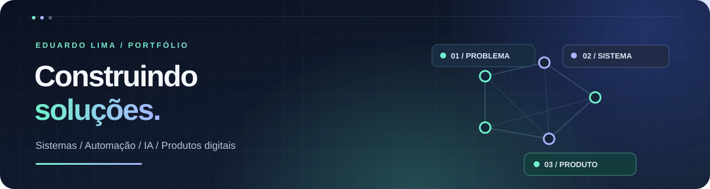
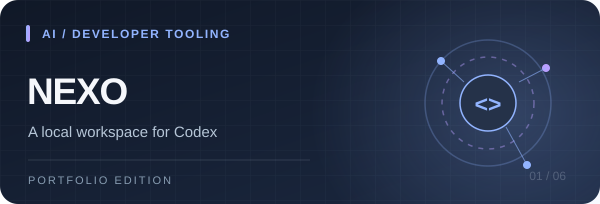
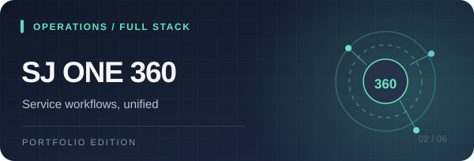
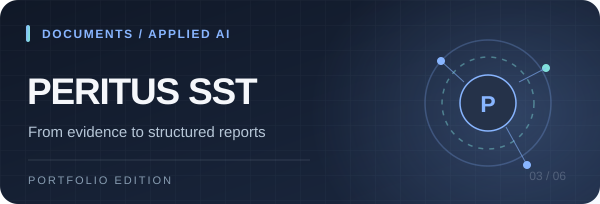
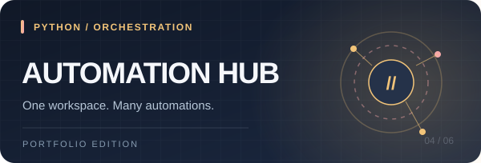
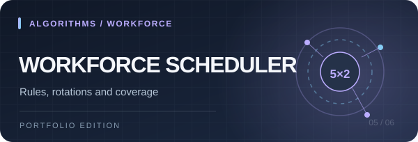
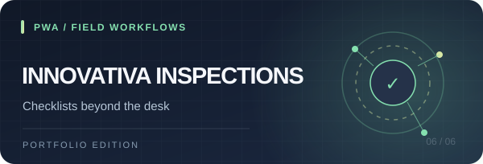

<a href="README.md">English</a> &nbsp;·&nbsp; <strong>Português (Brasil)</strong>

 

<h3>Desenvolvedor Full-Stack &nbsp;·&nbsp; Automação &nbsp;·&nbsp; Produtos com IA</h3>

<strong>Transformo processos confusos do mundo real em software simples de usar.</strong>

Projeto e desenvolvo aplicações, automações e ferramentas operacionais que tornam o trabalho diário mais claro, rápido e confiável.

<a href="#projetos-em-destaque"><strong>Conhecer os projetos ↓</strong></a> &nbsp;·&nbsp; <a href="#explorar-mais-projetos"><strong>Mais projetos ↓</strong></a> &nbsp;·&nbsp; <a href="#vamos-conversar"><strong>Contato ↓</strong></a>

---

## Projetos em destaque

Seis projetos, seis desafios diferentes — de ferramentas locais com IA a aplicações de campo.

| | |
| :--- | :--- |
|  **[Nexo — Interface para Codex](case-studies/nexo-codex.md)** Interface local com histórico de conversas, controles de modelos, aprovações e anexos. Python · JavaScript · Ferramentas de desenvolvimento |  **[SJ One 360 — Plataforma Operacional](case-studies/sj-one-360.md)** Atendimento, fluxos operacionais, indicadores e automação reunidos num sistema full-stack. React · TypeScript · Python · SQLite |
|  **[Peritus SST — Inteligência Documental](case-studies/peritus-sst.md)** OCR e IA opcional para organizar evidências e produzir laudos estruturados sob revisão profissional. Python · OCR · DOCX · IA assistiva |  **[SAC Automation Hub — Orquestração](case-studies/sac-automation-hub.md)** Central local para iniciar, agendar e monitorar diferentes automações operacionais. Python · Processos · Agendamentos |
|  **[Sistema de Escalas — Motor de Regras](case-studies/sistema-escalas-sac.md)** Escalas 5×2, cobertura de finais de semana, rodízios, permissões e auditoria. Python · SQLite · Escalas · CI |  **[Innovativa Inspeções — PWA de Campo](case-studies/innovativa-inspecoes.md)** Protótipo responsivo para inspeções e checklists, com persistência local e fluxo amigável para uso offline. JavaScript · PWA · UX de campo |

As artes acima são ilustrativas. As páginas vinculadas contêm apresentações documentais. Os repositórios de implementação e seus históricos são privados.

---

## ◇ Minha forma de desenvolver

<table>
<tr>
<td width="25%" valign="top"><b>01 · Entender</b> Começar pelas pessoas, dificuldades e pelo processo real.</td>
<td width="25%" valign="top"><b>02 · Desenhar</b> Modelar estados, regras, exceções e experiência de uso.</td>
<td width="25%" valign="top"><b>03 · Construir</b> Conectar interface, lógica, dados e integrações.</td>
<td width="25%" valign="top"><b>04 · Evoluir</b> Testar, monitorar, documentar e melhorar.</td>
</tr>
</table>

**Do problema → ao produto funcionando.** Esse é o fio condutor da maior parte dos meus projetos.

---

## ◎ O que eu desenvolvo

| **Plataformas operacionais** | **Automação e integrações** | **IA aplicada e documentos** |
| :--- | :--- | :--- |
| Sistemas internos, filas, dashboards, permissões e relatórios. | Ferramentas locais, orquestração e eliminação de tarefas repetitivas. | Interfaces com IA, OCR, organização de evidências e laudos estruturados. |

## ⌘ Tecnologias

| Área | Ferramentas |
| :--- | :--- |
| **Frontend e UX** | `React` · `TypeScript` · `JavaScript` · `HTML` · `CSS` · `PWA` |
| **Backend e automação** | `Python` · `FastAPI` · `Node.js` · `APIs REST` |
| **Dados e processos** | `SQLite` · `Automação com Excel` · `Processamento de documentos` |
| **Engenharia** | `Git` · `GitHub Actions` · `Ferramentas locais` |

---

## Explorar mais projetos

**[Conheça nove projetos documentados](projects/README.pt-BR.md)** — apresentações individuais em português e inglês; este catálogo não inclui arquivos de implementação.

Além dos destaques, publiquei ferramentas para atendimento, finanças, sites comerciais e pesquisa em SST.

<b>Operações e atendimento · 4 projetos</b>

- [Central de Atendimento Digital](case-studies/digital-service-center.md) — tickets e fluxos operacionais.
- [Controle de Pendências](case-studies/pending-cases-tracker.md) — tratamento de casos e filas de acompanhamento.
- [Central de Verificação de Devoluções](case-studies/returns-verification-center.md) — monitoramento e classificação de respostas.
- [Ouvidoria + WhatsApp](case-studies/ombudsman-whatsapp-automation.md) — organização e preparação de contatos.

<b>Finanças, comércio e comunicação · 4 projetos</b>

- [Central de Automação Financeira](case-studies/financial-automation-center.md) — conciliação e rotinas financeiras.
- [Suíte de Comunicação com Lojas](case-studies/store-communications-suite.md) — comunicações segmentadas e destinatários.
- [Automação de Termos de Retirada](case-studies/pickup-term-automation.md) — geração de termos e rastreabilidade de envios.
- [Toolkit de Automações Operacionais](case-studies/operations-automation-toolkit.md) — utilitários de e-commerce e atendimento.

<b>Experiências web e pesquisa SST · 3 projetos</b>

- [Innovativa SST Website](case-studies/innovativa-sst-website.md) — planos empresariais e geração de leads.
- [Landing Pages Peritus SST](case-studies/peritus-sst-landing-pages.md) — três páginas de serviços com calculadoras.
- [Laboratório de Automação de Laudos SST](case-studies/sst-report-automation-lab.md) — análise de acervo, classificação e anonimização.

---

## ▦ Meu portfólio em números

| **17** | **06** | **03** |
| :---: | :---: | :---: |
| Projetos documentados | Projetos em destaque | Especialidades principais |
| Sistemas e automações | Desafios técnicos distintos | Full-stack · Automação · IA aplicada |

> Os projetos públicos destacam **arquitetura, resolução de problemas e processos reais**. As apresentações vinculadas contêm somente documentação. Os repositórios de implementação e seus históricos são privados.

---

## ↗ Em que estou focado

- Melhorar a experiência de uso de ferramentas locais com IA.
- Criar automações que conectam sistemas existentes.
- Desenvolver software confiável e fácil de usar por equipes operacionais.
- Transformar automações pontuais em produtos mais estruturados.

---

## Vamos conversar

<h3>Vamos construir algo útil.</h3>

<strong>Tem um processo operacional que poderia ser mais simples?</strong>

Tenho interesse em automação, plataformas internas, ferramentas de desenvolvimento e produtos com boa experiência de uso.

<a href="https://github.com/EduSchorr?tab=repositories"><strong>Ver repositórios</strong></a> &nbsp;·&nbsp; <a href="README.md"><strong>Read in English</strong></a>

Brasil 🇧🇷 · Construir coisas úteis. Melhorar. Evoluir.

